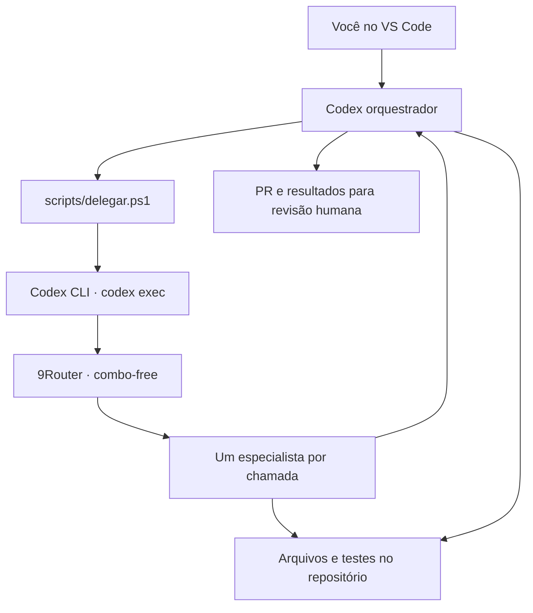

# Fábrica de Software Agêntica Semi-autônoma

**Projeto Final 4 · OpenAI Codex no VS Code · 9Router · GitHub Spec Kit**

Esta é a adaptação da fábrica apresentada na disciplina para o OpenAI Codex. Você descreve uma funcionalidade no chat da extensão do VS Code. O Codex coordena seis especialistas, confere suas entregas e conduz o trabalho até um pull request (PR). Você aprova a especificação e faz o merge no GitHub. O material do professor está na [página da aula](src/fabrica-aula.html).

## Situação da preparação

Registro da preparação em **21/11/2026**.

| Item | Situação registrada |
| --- | --- |
| `uv` | Instalação e comando de versão confirmados no terminal do VS Code |
| Codex CLI | Instalação confirmada após a mensagem `codex not found` |
| Spec Kit | Versão **1.4.3**, registrada também em `.specify/init-options.json` |
| Inicialização | Comando concluído com a mensagem **Project ready** |
| Skills | Instaladas em `.agents/skills/speckit-*/SKILL.md` |
| Constituição | Proposta **1.0.0**, com sete princípios e `TODO(RATIFICATION_DATE)` pendente |
| 9Router | Combo `combo-free` e endereço `http://localhost:20128/v1` no arquivo de configuração |
| Git | Branch atual `main`, com a preparação ainda por salvar em commit |
| GitHub | Remoto `origin` ainda por configurar nesta cópia. Autenticação do `gh` a conferir |
| Execução da fábrica | Primeira feature e integração de ponta a ponta com o 9Router aguardam validação |

**Para continuar desta situação, siga a [aprovação da constituição](#aprovar-a-proposta) e a [preparação do GitHub](#preparar-git-e-github).** As instruções de instalação abaixo servem também para preparar outra máquina.

## Como o projeto funciona

O chat do Codex assume a função de orquestrador ao ler [AGENTS.md](AGENTS.md) e [src/orquestrador.md](src/orquestrador.md). Ele escolhe a etapa, prepara a branch, monta o handoff e espera a resposta de cada especialista. Handoff é a mensagem com o objetivo da etapa, os arquivos de entrada, as decisões já tomadas e o formato da entrega.



O [script de delegação](scripts/delegar.ps1) lê as instruções do papel em `src/subagent-*.md`, junta o handoff e inicia `codex exec` na raiz deste repositório. Cada chamada usa o provedor do 9Router e o combo de [src/9router.json](src/9router.json). O orquestrador confere os arquivos e os comandos de verificação antes de avançar.

As execuções dos especialistas usam `--sandbox workspace-write`, `--ephemeral` e `agents.enabled=false`. O primeiro permite trabalhar nos arquivos do projeto conforme as permissões do ambiente. O segundo evita guardar o histórico da sessão do especialista. O terceiro desativa novas delegações dentro dessa execução. As entregas continuam registradas nos arquivos do repositório.

As responsabilidades e os caminhos permitidos a cada papel são instruções verificadas pelo orquestrador nas alterações. O script também confere a branch e a aprovação registrada antes das chamadas posteriores à especificação.

A conversa principal usa a conta e o modelo selecionados na extensão. Os especialistas recebem chamadas independentes para usar o 9Router, porque os subagentes nativos do Codex herdam o provedor da conversa principal. Essa ponte foi acrescentada nesta adaptação. [Documentação de subagentes do Codex](https://learn.chatgpt.com/docs/agent-configuration/subagents#custom-agents)

## O que existe em cada pasta

| Caminho | Função | Como foi criado |
| --- | --- | --- |
| `AGENTS.md` | Entrada das instruções da fábrica para o Codex | Adaptação para o VS Code |
| `src/orquestrador.md` | Etapas, critérios, checkpoints, handoffs e estado | Agente do professor adaptado |
| `src/subagent-*.md` | Responsabilidades dos seis especialistas | Agentes do professor adaptados |
| `src/9router.json` | Endereço da API e nome do combo | Configuração acrescentada na adaptação |
| `scripts/delegar.ps1` | Chama um especialista com `codex exec` pelo 9Router | Ponte acrescentada na adaptação |
| `.agents/skills/` | Procedimentos do Spec Kit que o Codex pode seguir | `specify init` |
| `.specify/scripts/` | Scripts auxiliares usados pelas skills | `specify init` |
| `.specify/templates/` | Modelos dos documentos de requisitos, plano, tarefas e constituição | `specify init` |
| `.specify/init-options.json` e `integration.json` | Versão, integração e opções da instalação | `specify init` |
| `.specify/memory/constitution.md` | Regras gerais do projeto | Modelo instalado e conteúdo preparado por `$speckit-constitution` |
| `specs/<feature>/` | Especificação, plano, tarefas, estado e relatórios de uma funcionalidade | Surge durante a execução da primeira feature |

O código do produto será gerado neste mesmo repositório, nos locais definidos pelo plano técnico. O Arquiteto registra os comandos para executar e verificar o produto em `plan.md` e `quickstart.md` da feature.

## Instalar as ferramentas no Windows

Abra a pasta `fabrica-software-agentica` pelo menu **Arquivo → Abrir Pasta** do VS Code. Use **Terminal → Novo Terminal** para os comandos PowerShell abaixo. Confira com `Get-Location` que o caminho termina nessa pasta.

### Instalar uv

O `uv` instala ferramentas Python em ambientes próprios. Foi usado para instalar a CLI do Spec Kit.

```powershell
winget install --id=astral-sh.uv -e
```

Salve os arquivos, feche as janelas do VS Code e abra o projeto novamente para carregar o caminho dos comandos. Confira a instalação.

```powershell
uv --version
```

O resultado esperado é o número da versão do `uv`. [Instalação oficial do uv](https://docs.astral.sh/uv/getting-started/installation/#winget)

### Instalar Codex CLI

A extensão oferece o chat no editor. O CLI fornece o comando `codex` que o Spec Kit procura e que o script usa para chamar os especialistas.

```powershell
powershell -ExecutionPolicy ByPass -c "irm https://chatgpt.com/codex/install.ps1 | iex"
```

O comando baixa e executa o instalador oficial. `ExecutionPolicy ByPass` vale para esse processo do PowerShell. Reabra o VS Code após a instalação e confira no novo terminal.

```powershell
codex --version
```

O resultado esperado é a versão do Codex CLI. A conversa principal será aberta na extensão, com o login da sua conta. [Instalação oficial do Codex CLI](https://learn.chatgpt.com/docs/codex/cli#getting-started)

### Instalar Spec Kit

```powershell
uv tool install specify-cli
specify version
```

O primeiro comando instala a ferramenta cujo executável se chama `specify`. O segundo consulta a versão. Nesta preparação, a saída mostrou **CLI Version 1.4.3**, Python 3.14.7 e Windows. [Instalação oficial do Spec Kit](https://github.github.io/spec-kit/installation.html#install-from-pypi)

### Inicializar o Spec Kit no projeto

Esta etapa já foi concluída nesta cópia. Para preparar uma pasta pela primeira vez, use o terminal na raiz do projeto.

```powershell
specify init --here --integration codex --script ps
```

| Opção | Significado |
| --- | --- |
| `--here` | Usa a pasta atual |
| `--integration codex` | Instala as skills da integração Codex |
| `--script ps` | Escolhe os scripts PowerShell |

Como a pasta já contém arquivos, o instalador pode apresentar a mensagem abaixo. Confira o diretório e revise o trabalho existente antes de confirmar a mesclagem dos templates.

```text
Warning: Current directory is not empty (...)
Template files will be merged with existing content and may overwrite existing files.
Do you want to continue? [y/N]:
```

Na preparação deste projeto, a primeira tentativa terminou em **codex not found**. A instalação do Codex CLI e a reabertura do VS Code resolveram a detecção. A segunda execução terminou com a saída abaixo, aqui abreviada.

```text
Project ready
You're already in the project directory!
Start Codex in this project directory;
spec-kit skills were installed to .agents/skills

$speckit-constitution
$speckit-specify
$speckit-plan
$speckit-tasks
$speckit-implement
$speckit-converge
```

**Project ready** confirma a preparação dos arquivos e das skills. A criação de uma feature começa depois, por um pedido seu no chat.

O comando `specify init` é executado no **terminal**. Nomes como `$speckit-constitution` são invocados no **chat do Codex**. Se um projeto já usa Spec Kit com outra integração, a instalação adicional do Codex é feita com `specify integration install codex`. [Integração oficial com Codex](https://github.github.io/spec-kit/integrations/codex.html)

## Criar e aprovar a constituição

A constituição reúne os princípios que os agentes devem seguir durante o trabalho. Nesta fábrica, eles tratam do controle humano, das responsabilidades dos papéis, dos documentos do Spec Kit, da rastreabilidade, das evidências de entrega, dos limites de correção e da integridade do repositório.

### Preparar a proposta

Abra uma nova conversa local na extensão Codex, com a pasta do projeto aberta. A mensagem abaixo foi usada para preparar a constituição atual.

```text
$speckit-constitution

Leia AGENTS.md, readme.md e os arquivos dos agentes em src/.

Crie a constituição do projeto com base nas regras já documentadas
para esta fábrica, incluindo responsabilidades dos agentes,
aprovação humana, rastreabilidade e verificação das entregas.

Trabalhe apenas na preparação da constituição.
Ao terminar, explique cada princípio para eu revisar e aprender.
```

O resultado ficou em [.specify/memory/constitution.md](.specify/memory/constitution.md), como proposta de versão **1.0.0**, com sete princípios, responsabilidades dos papéis, critérios de E0 a E8 e governança. O modelo anterior continha campos genéricos. A proposta atual tem data de adoção pendente e um comentário inicial temporário, chamado `Sync Impact Report`, para apoiar a revisão.

### Aprovar a proposta

Leia o arquivo e confira os princípios. Após concordar com a versão, você pode enviar a mensagem abaixo na mesma conversa do Codex.

```text
$speckit-constitution

Revisei e aprovo a proposta 1.0.0 da constituição.
Finalize apenas a constituição para esta aprovação.

Registre a data de ratificação de hoje em YYYY-MM-DD,
atualize a situação e a governança para refletirem a versão aprovada
e remova o Sync Impact Report temporário antes de salvar a versão final.

Apresente as alterações para eu conferir.
```

Ao final, confira a versão `1.0.0`, a data real no campo `Ratified` e a situação de aprovada. A aprovação da constituição registra a adoção das regras gerais. Cada funcionalidade terá sua própria especificação e aprovação no Checkpoint 1.

## Preparar Git e GitHub

O fluxo definido no [orquestrador](src/orquestrador.md) usa uma branch por feature e termina com um PR no GitHub. Para isso, a base precisa estar salva em commit, o remoto `origin` deve apontar para um repositório em que você possa publicar e o GitHub CLI precisa estar autenticado.

### Preparar o GitHub CLI

Confira o comando no terminal do VS Code.

```powershell
gh --version
```

Para instalar no Windows, use o WinGet. Reabra o VS Code ao terminar.

```powershell
winget install --id GitHub.cli --source winget
```

Faça a autenticação e confira o resultado. Em `gh auth login`, siga o fluxo de login apresentado para sua conta do GitHub.

```powershell
gh auth login
gh auth status
```

O resultado de `gh auth status` deve indicar a conta autenticada. [Instalação do GitHub CLI no Windows](https://github.com/cli/cli/blob/trunk/docs/install_windows.md) · [Autenticação do gh](https://cli.github.com/manual/gh_auth_login)

### Configurar o remoto

Nesta cópia, `git remote` retornou vazio na revisão de 21/11/2026. Crie um repositório vazio na sua conta do GitHub e copie seu endereço HTTPS. O exemplo abaixo contém valores que você deve substituir pelo seu usuário e repositório.

```powershell
git remote add origin https://github.com/SEU_USUARIO/SEU_REPOSITORIO.git
git remote -v
```

Em uma cópia que já tenha remoto, confira o destino com `git remote -v` antes de configurar a publicação.

### Salvar a preparação

Depois de finalizar a constituição e revisar a adaptação, salve os arquivos no Git.

```powershell
git status --short
git add AGENTS.md readme.md src scripts .agents .specify
git diff --cached --stat
git diff --cached --name-only
git commit -m "docs: adapta fabrica ao Codex e prepara Spec Kit"
```

Confira a lista de arquivos preparados para o commit. Credenciais reais devem ser armazenadas na configuração local de autenticação ou em variáveis de ambiente.

A base atual é `main`. Publique-a no repositório que você configurou. Em um projeto cuja base tenha outro nome, use o nome correspondente.

```powershell
git push -u origin main
git status --short
```

A saída de `git status --short` deve estar vazia ao iniciar a primeira feature. O orquestrador usa a branch base para criar a branch da funcionalidade.

## Configurar e manter o 9Router disponível

Inicie o 9Router pelo procedimento da sua instalação e mantenha-o disponível durante as delegações. No painel, confira o combo **combo-free** e os modelos que ele pode usar. A estratégia de fallback do combo determina a tentativa do próximo modelo em caso de indisponibilidade. [Projeto 9Router](https://github.com/decolua/9router)

A configuração atual de [src/9router.json](src/9router.json) é a seguinte.

```json
{
  "base_url": "http://localhost:20128/v1",
  "modelo": "combo-free"
}
```

`base_url` é o endereço da API. `modelo` é o nome exato do combo no roteador. Se você mudar o endereço, a porta ou o nome do combo, atualize esses campos.

Quando a autenticação por chave estiver habilitada no 9Router, crie a variável de usuário **FABRICA_9ROUTER_API_KEY** nas configurações de variáveis de ambiente do Windows e reabra o VS Code. O script lê a chave dessa variável. No modo local com autenticação desativada, ele usa um valor de teste quando a variável está vazia.

O nome do combo identifica o roteamento. O custo e as cotas dependem dos modelos e provedores que você incluir. O mesmo combo atende os seis papéis, e diferentes papéis podem ser atendidos pelo mesmo modelo.

### Diagnosticar uma delegação que falhou

O teste de conexão do painel verifica a credencial ou o acesso ao catálogo. Ele não executa o fluxo de ferramentas do Codex nem garante cota disponível para uma geração. Um modelo precisa atender ao pedido e oferecer suporte às ferramentas usadas pelo especialista.

Quando `codex exec` termina com erro, o lançador mostra as últimas 40 linhas e informa o caminho de um log completo do CLI em `%TEMP%`, fora do repositório. Antes de preservar esse arquivo, ele remove a chave efetiva do roteador e padrões comuns de credenciais. Na execução bem-sucedida, o arquivo temporário é removido. Examine o log localmente e revise seu conteúdo antes de compartilhá-lo; ele também pode conter trechos dos documentos lidos pelo especialista.

O log registra o que o CLI recebeu. Se o 9Router retornar apenas o erro de um destino depois do fallback, esse arquivo não recupera os erros que o roteador descartou. Um HTTP 410 de modelo indisponível pode aparecer junto de falhas de cota ou de ferramentas em outros destinos. Confira também os registros e o estado dos provedores no painel.

No OpenRouter, variantes gratuitas podem compartilhar uma cota diária. Trocar entre modelos `:free` não reinicia esse limite. A consulta autenticada `GET https://openrouter.ai/api/v1/key`, feita com a chave do **OpenRouter**, permite conferir `free_model_daily_requests`, quando disponível; a chave local do 9Router não autentica essa consulta. Confira `used`, `limit` e `remaining` e, em caso de esgotamento, aguarde a renovação indicada pelo provedor. Os limites dependem da conta e podem mudar. [Limites oficiais do OpenRouter](https://openrouter.ai/docs/api/reference/limits)

## Rodar a primeira feature pelo VS Code

Com a constituição aprovada, a preparação salva e publicada, o `gh` autenticado e o 9Router disponível, abra uma conversa local da extensão Codex na raiz do projeto. O modelo selecionado nessa conversa será o orquestrador.

### Enviar a demanda

Use uma demanda sua ou o exemplo abaixo, baseado na atividade de data e hora do material do professor.

```text
Inicie uma feature da fábrica seguindo AGENTS.md e src/orquestrador.md.

Crie uma aplicação web simples que mostre a data e a hora do servidor
em vermelho, no formato pt-BR e no fuso America/Sao_Paulo.
A informação deve ser carregada uma vez ao abrir a página.

Pare no Checkpoint 1 para eu revisar a especificação.
```

O Codex executa a descoberta E0, aciona o Analista pelo 9Router e recebe a especificação. O orquestrador prepara a branch com o nome da feature e registra o estado. Os arquivos esperados ao fim de E1 ficam em `specs/<feature>/`, incluindo `spec.md`, `checklists/requirements.md` e `state.json`. Perguntas de requisito podem voltar para você antes de a spec ficar pronta.

### Revisar e aprovar a especificação

Abra a `spec.md` indicada pelo Codex e confira o comportamento proposto. Para ajustar o exemplo, você pode escrever “A cor vermelha deve ser em tom escuro”. O orquestrador encaminha o pedido ao Analista por `speckit-clarify` e apresenta a spec atualizada para revisão.

Depois de revisar, a mensagem abaixo autoriza o plano e as etapas técnicas seguintes.

```text
Aprovo a especificação apresentada. Continue o fluxo da fábrica.
```

Para guardar a spec aprovada e escolher outro momento para implementar, use a mensagem abaixo.

```text
Aprovo esta especificação. Pare aqui e aguarde meu pedido para continuar.
```

Nesse caso, o estado fica em `ESPECIFICACAO_APROVADA`. O orquestrador registra sua mensagem literal para permitir a retomada.

### Acompanhar a implementação

Após a aprovação com continuidade, o Codex coordena o plano, as tarefas, a análise, a implementação por fase, a revisão e o QA. Os especialistas trabalham um de cada vez. O orquestrador executa os comandos de verificação do plano e encaminha as correções a quem é responsável pelo artefato.

Dúvidas técnicas são resolvidas e registradas pelos especialistas. Mudanças de requisito voltam para sua decisão. Há limite de duas devoluções por etapa e cinco rodadas globais de correção por feature, conforme o fluxo.

### Receber o PR e concluir a entrega

Ao concluir as verificações, o orquestrador publica a branch e abre o PR com os resultados, relatórios e pendências. O estado fica em `AGUARDANDO_MERGE`. Você revisa o PR e faz o merge no GitHub.

Em repositórios com CI, o orquestrador acompanha os checks. Se o repositório usa somente verificações locais, essa condição e os resultados ficam documentados no estado e no PR.

Ao retomar a conversa, peça ao Codex para verificar o merge da feature. Ele consulta o GitHub e registra `ENTREGUE` após confirmar o merge.

### Retomar em outra conversa

Abra a mesma pasta e envie o pedido abaixo, substituindo `<feature>` pelo nome real do diretório em `specs/`.

```text
Retome a feature <feature> a partir do state.json.
Siga o fluxo de src/orquestrador.md e respeite as aprovações
e os pedidos de pausa já registrados.
```

O `state.json` guarda a branch, a etapa, as tarefas concluídas, os artefatos, os comandos de verificação, os contadores e os checkpoints. A retomada continua a primeira etapa pendente.

## Entregas e papéis de cada etapa

| Etapa | Responsável | Skill ou entrega principal |
| --- | --- | --- |
| E0 | Codex orquestrador | Conferência dos pré-requisitos e do estado existente |
| E1 | [Analista](src/subagent-analista-requisitos.md) | `speckit-specify`, `speckit-clarify` e checklists. Entrega `spec.md` |
| Checkpoint 1 | Você | Revisão e aprovação da especificação |
| E2 | [Arquiteto](src/subagent-arquiteto.md) | `speckit-plan`. Entrega `plan.md`, `research.md`, `quickstart.md` e artefatos aplicáveis |
| E3 | [Criador de Tarefas](src/subagent-criador-tarefas.md) | `speckit-tasks`. Entrega `tasks.md` com fases e IDs |
| E3.5 | Codex orquestrador | `speckit-analyze`. Confere consistência e cobertura dos requisitos |
| E4 | [Desenvolvedor](src/subagent-desenvolvedor.md) | `speckit-implement`. Entrega código e testes e marca tarefas verificadas com `[X]` |
| E5 | [Revisor](src/subagent-revisor-codigo.md) | `review-report.md` com achados e parecer |
| E6 | [QA](src/subagent-qa.md) | Testes de aceite e `qa-report.md` com execução e defeitos |
| E7 | Codex orquestrador | Branch publicada, PR e resultados da CI ou validação local |
| E8 / Checkpoint 2 | Você e Codex | Você faz o merge. O Codex confirma e registra a entrega |

`speckit-checklist` complementa as verificações por domínio. `speckit-converge` também foi instalado e serve para avaliar o código e acrescentar trabalho restante como tarefas. O fluxo definido nesta fábrica usa a sequência da tabela e as devoluções descritas no [orquestrador](src/orquestrador.md).

Cada retorno de especialista termina com um bloco de status. `PARECER` é incluído pelo Revisor e pelo QA quando a avaliação foi realizada.

```text
STATUS: DONE | BLOCKED | NEEDS_CLARIFICATION | HUMAN_REVIEW_REQUIRED
PARECER: aprovado | aprovado com ressalvas | reprovado
ARTEFATOS: caminhos dos arquivos criados ou alterados
TESTES: comandos executados e códigos de saída
BLOQUEIOS: itens pendentes
PRÓXIMO: etapa sugerida
```

Os critérios completos de avanço, de severidade dos achados e de correção estão em `src/orquestrador.md` e na constituição. O fluxo reserva o merge do PR à decisão humana. As operações Git e a publicação são conduzidas pelo orquestrador dentro das regras desses documentos.

## Mensagens encontradas na preparação

| Mensagem | Significado e ação |
| --- | --- |
| `uv` não reconhecido | Instale o uv e reabra o VS Code para carregar o caminho do executável |
| `codex not found` no `specify init` | O Spec Kit procurou o CLI no terminal. Instale o Codex CLI, reabra o VS Code, confira `codex --version` e repita a inicialização |
| `Current directory is not empty` | O instalador vai mesclar os templates na pasta atual. Confira o diretório e o trabalho existente antes de confirmar |
| `Project ready` | As skills e os arquivos de apoio foram preparados. Continue pela criação ou revisão da constituição |
| `TODO(RATIFICATION_DATE)` na constituição | A proposta aguarda aprovação e registro da data real de adoção |
| Branch ou aprovação incompatível na delegação | O script exige que a feature, a branch, a etapa e a aprovação registrada correspondam ao acionamento pedido pelo orquestrador |

A execução de ponta a ponta será comprovada pela primeira feature com artefatos, testes executados, relatórios e PR. Esses resultados permitirão demonstrar a adaptação na entrega da atividade.
